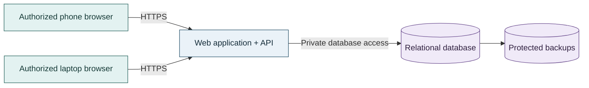
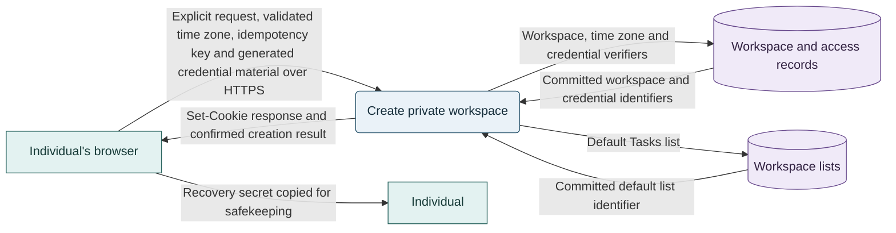
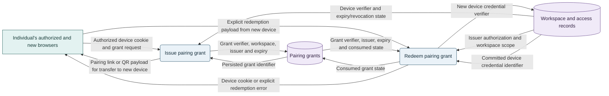
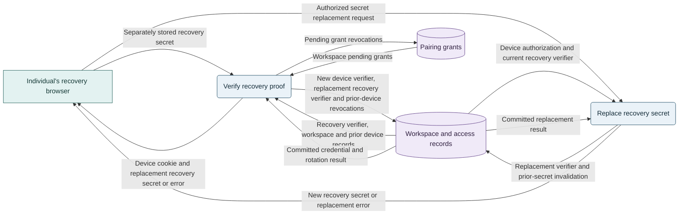
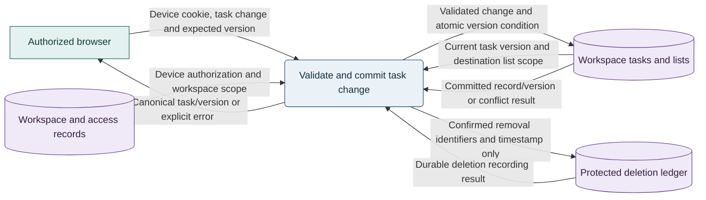
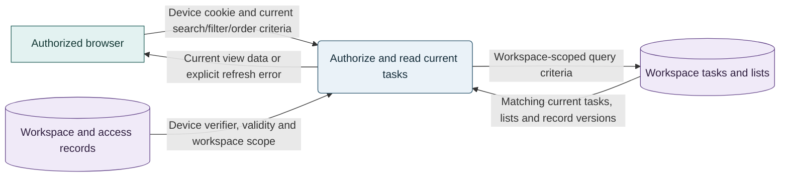
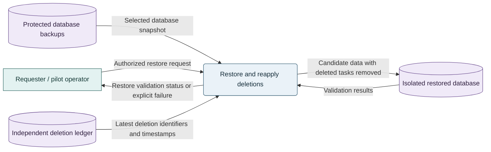

# Task Manager MVP Architecture Specification

**Status:** Approved by requester on 2026-11-12; explicit open decisions remain unresolved.
**Date:** 2026-11-12

## 1. Purpose and Evidence

Specify the architecture for private, cross-device task management without required accounts. This document complements the [product requirements](task-manager-requirements.md) and [MVP plan](task-manager-mvp-plan.md). It does not replace their product scope or authorize implementation.

The repository currently contains planning documents, not an implemented application. No existing runtime stack, measured workload, hosting constraint, budget, or team capacity was supplied.

Architecture discussions added cross-device access, device pairing and recovery, and synchronization decisions after the original product documents were approved. The product requirements and MVP plan now record the confirmed product-level refinements; technical controls and deployment details remain here.

### Decision status

| ID | Decision | Status and basis |
| --- | --- | --- |
| AD-01 | Private task spaces; no required accounts. | Approved in Milestone 1. |
| AD-02 | The MVP must support cross-device access. | Confirmed by requester in this chat. |
| AD-03 | Add devices using a short-lived, single-use pairing link or QR code from an authorized device; support individual device revocation. | Proposed experience approved by requester. |
| AD-04 | Provide a separately stored recovery secret. Losing all authorized devices and that secret makes recovery unavailable. | Proposed experience approved by requester. |
| AD-05 | Refresh on opening, returning to the app, or manual request; no periodic polling or live updates. | Approved by requester. |
| AD-06 | Use a hosted modular monolith and relational database. | Approved with this specification on 2026-11-12. |
| AD-07 | Use server-confirmed saves and version-based conflict detection. | Approved with this specification on 2026-11-12. |
| AD-08 | Use React 19/TypeScript 5.9, Node.js LTS/Vite, .NET 10 LTS/EF Core 10/Npgsql, PostgreSQL 18, Vitest/Testing Library, Playwright, and xUnit. | Selected by requester on 2026-11-12; pin compatible patch versions during implementation setup. |
| AD-09 | If browser time-zone detection fails validation, require explicit selection of a supported IANA zone; do not silently fall back. | Selected by requester on 2026-11-12. |
| AD-10 | Use 256-bit device and recovery tokens, store SHA-256 verifiers only, apply a fixed 90-day host-only `__Host-` Secure/HttpOnly/SameSite=Lax cookie, and enforce CSRF token and Origin checks on mutations. Keep initial raw tokens in page memory for same-operation retries only. | Selected by requester on 2026-11-12; detailed in Sections 5 and 8. |

The requester approved this specification on 2026-11-12. Its technical controls form the approved design baseline, not evidence that they are implemented or validated. The stack and Slice 1 details in AD-08 through AD-10 were subsequently selected; hosting, operations, and other explicit open choices remain unresolved. Approval does not authorize implementation.

## 2. Goals, Scope, and Constraints

- Implement TM-01 through TM-13: task capture, editing, state, named lists, search, filtering, ordering, calendar due status, removal, cross-device access, pairing/revocation, recovery, and configurable workspace time zone.
- Make the same private task space available to its authorized devices.
- Do not require registration, email, passwords, or an external identity provider.
- Keep operational complexity proportionate to an individual-task-manager MVP.
- Preserve the approved 30-day pilot and walkthrough/survey measurement approach. Do not introduce task-content analytics as a substitute.
- Exclude team sharing, assignment, comments, attachments, reminders, recurrence, time tracking, integrations, and billing.
- Offline editing is not an approved requirement and is excluded from this design.
- Performance, availability, recovery-time, recovery-point, and cost targets remain TBD. No numeric service-level commitment is established here.

## 3. Architecture Overview

**Color legend:** Teal = client devices; blue = application; purple = persistent storage, including backups. Node labels and storage shapes preserve meaning without color.

The browser is an untrusted client. The application authenticates device credentials, authorizes workspace access, validates operations, and commits data. The database is the authoritative store; browser state is a temporary view, not a second source of truth.

Prefer a same-origin web interface and API to simplify cookie security and deployment. Use one backend deployment with internal module boundaries. Do not introduce microservices, message brokers, event sourcing, separate read databases, or a distributed cache without evidence of need.

### Component responsibilities

| Component | Responsibility |
| --- | --- |
| Web interface | Task/list workflows, pairing and recovery screens, refresh triggers, validation feedback, and explicit save/error states. |
| Workspace access module | Create private workspaces; verify initial device credentials; pair, list, and revoke devices; verify recovery proofs. |
| Tasks module | Create, edit, complete, reopen, remove, search, filter, and order tasks within the authenticated workspace. |
| Lists module | Create named lists and move tasks between lists; enforce workspace ownership for both task and destination list. |
| Persistence layer | Transactions, scoped queries, constraints, schema migrations, and atomic version checks. |
| Operational facilities | Health checks, sanitized logs, metrics, secrets management, database backups, and tested restoration. |

Organize implementation by end-to-end feature slices within these boundaries. Share workspace authorization, validation conventions, persistence primitives, and error handling rather than duplicating them in each slice.

## 4. Logical Data Model

The following is the architectural logical model, not a finalized schema. Explicit provisional details and product clarifications below remain unresolved.

| Entity | Important data and invariants |
| --- | --- |
| Workspace | Opaque ID, creation timestamp, and configurable IANA time-zone identifier; isolation boundary, not a registered account. |
| Task | ID, workspace ID, title, optional description, optional date-only due date, optional Low/Medium/High priority, state, required list ID, creation/update timestamps, version, and current completion instant/calendar date when complete. |
| Named list | ID, workspace ID, name, and version. |
| Device credential | ID, workspace ID, verifier for an opaque random credential, issue time, expiry, and revocation state. Never store the raw credential. |
| Pairing grant | Workspace ID, issuing device ID, random-token verifier, expiry, and consumed/revoked state. |
| Recovery credential | Workspace ID, verifier for a separately issued high-entropy secret, and rotation state. |
| Deletion ledger entry | Opaque workspace/task IDs and deletion timestamp; no task content or credentials. Preserved independently of database backup restoration. |

Enforce these invariants in application logic and database constraints where possible:

- Every task and list belongs to exactly one workspace.
- Every task belongs to a named list in that same workspace. Workspace creation creates a default list named Tasks.
- All task/list reads and writes are scoped to the authenticated workspace.
- A missing or blank title fails validation with actionable feedback.
- Due dates are date-only values. Operational timestamps are UTC instants.
- Completed tasks are not presented as needing completion.
- State changes and version increments commit atomically.
- A stale mutation cannot overwrite a newer version or recreate a removed task.

### Approved task and list rules

These refinements were confirmed through requester decision forms on 2026-11-12:

- Priority is Low, Medium, High, or unset.
- Text search is a case-insensitive literal substring match against the title only, not the description. Search and selected filters combine with AND.
- Default ordering is newest creation first. Due-date ordering is soonest first with undated tasks last. Priority ordering is High, Medium, Low, then unset. Ties use newest creation and then a stable task ID.
- Every task requires a named list. The automatically created Tasks list supports first-task capture without separate list setup; there is no unfiled/Inbox mode.
- Trim leading/trailing whitespace from list names; reject empty names and case-insensitive duplicates within a workspace.
- List removal is outside the MVP. Users can create named lists and move tasks between them.
- Confirmed task removal deletes the live task immediately, with no trash or undo. Protected backups may retain deleted content for at most 30 days, subject to the restore safeguards in Section 9.
- Whole-workspace deletion is deferred outside the MVP. Do not automatically delete inactive workspaces during the pilot; review this policy before broader release.

## 5. Principal Data Flows

The following Mermaid data flow diagrams use rectangles for external entities, rounded nodes for backend processes, and cylinders for logical persistent stores. Teal = client/user; blue = backend process; purple = stored data. Each arrow names exchanged data rather than execution order. All browser/backend exchanges cross the untrusted-client boundary over HTTPS; stores are inside the private backend boundary. The logical stores share the relational database, not separate services. Prose below defines ordering, atomicity, and failure behavior.

### First use

The browser-to-individual exchange represents the approved manual safekeeping experience, not automatic browser persistence. Raw tokens are generated with the browser's cryptographically secure random source and held in page memory; they are not persisted by the browser or server.

1. The user explicitly starts a private workspace.
2. The browser detects its IANA time-zone identifier and validates it. If unavailable or invalid, require explicit selection of a supported IANA zone; never silently use the server zone or UTC.
3. The browser generates independent 256-bit device and recovery tokens and a workspace-creation idempotency key. It sends these only over HTTPS, held in page memory, with the explicit creation request. The backend stores SHA-256 verifiers only and atomically creates the workspace, default Tasks list, and access records. IDs use cryptographically secure randomness.
4. On confirmation, the backend sets the device token in a host-only `__Host-` cookie with `Secure`, `HttpOnly`, `SameSite=Lax`, `Path=/`, no `Domain`, and a fixed 90-day expiry. The browser presents the recovery secret for separate safekeeping.
5. The interface explains that recovery requires an authorized device or that secret. A same-page retry after a lost response resubmits the same idempotency key and token material; the server returns the original operation outcome and does not create another workspace. If page memory is lost, the raw tokens cannot be recovered; explicitly warn and require user confirmation before starting a separate workspace. No automatic cleanup is introduced.

### Pair another device

The external entity groups the same individual's two browsers; the user transfers the grant between them. The backend does not push credentials to an unpaired device. Grant consumption and device issuance form one atomic transaction.

1. An authorized device requests a single-use pairing grant for its workspace that expires 10 minutes after issuance.
2. The user transfers its link or QR code to the new device.
3. The new device explicitly submits the grant for redemption. Merely fetching a link must not consume it or issue credentials.
4. The backend atomically verifies expiry, issuer authorization, and unused status; consumes the grant; and issues a distinct device credential.
5. Replay, expiry, or revocation fails explicitly. The new device can then fetch the workspace's current tasks.

A pairing grant is a bearer credential: anyone possessing it before redemption could gain access. Prefer fragment-based transfer with immediate URL cleanup, no third-party scripts on the redemption page, and restrictive referrer policy. Do not place secrets in query strings, access logs, analytics, or screenshots.

Device credentials expire 90 days after issuance with no sliding extension. Initial and recovered devices follow the same fixed lifetime. An expired device must pair again from an authorized device or use recovery.

If redemption commits but the new browser loses the credential response, fail closed: do not replay the consumed grant. Generate a fresh grant from the original authorized device, which remains usable. The orphaned credential receives no usable browser access and can be revoked through the device list.

### Recover access

Successful recovery automatically rotates the secret. Explicit secret replacement from an authorized device remains a separate capability.

1. The user submits the separately stored recovery secret over HTTPS.
2. Under rate limits, the backend atomically verifies the current secret, revokes all previous device credentials and pending pairing grants, invalidates the old recovery secret, and issues a new device credential and replacement recovery secret for the same workspace. Concurrent uses of the old secret cannot both succeed.
3. Show the replacement recovery secret for separate safekeeping. The recovered browser receives a new 90-day credential; prior devices must pair again.
4. Explicit secret replacement also invalidates the prior secret atomically.

Recovery is access restoration, not database backup restoration. No email or support-based identity recovery is assumed. A lost recovery response can leave the user without usable access because the old secret and devices are revoked; response-loss handling is a remaining implementation-specification decision, not an approved silent retry or rollback policy.

### Change a task

For removal, the confirmed response identifies the removed task and outcome rather than returning a live task record. Removal metadata flows to the ledger only after authorization and a successful version check; other mutations do not write deletion entries. Do not confirm removal until both live deletion and its independently durable ledger entry are secured. Recovery and retry coordination must not resurrect a removed task or falsely report success if either persistence step fails.

1. The client submits the change and its last known record version.
2. The backend validates credentials, workspace scope, input, and version.
3. It commits the mutation and version increment in one transaction, or conditionally deletes the live row for removal. Completed tasks receive current completion fields; reopening clears them.
4. Only a confirmed commit permits a "Saved" state. The response supplies the canonical record and version.
5. A version mismatch rejects the mutation. The interface preserves unsaved input and offers review against current data rather than silently merging or overwriting.

The same atomic version check applies to completion, reopening, moving, and removal. A confirmed task removal must be authorized and cannot be undone by a stale edit from another device.

## 6. Synchronization and Failure Behavior

### Approved freshness model

Fetch current workspace data:

- When opening the application.
- When returning to its visible, active view, including returning from another browser tab or application.
- When the user invokes Refresh.

A successful local mutation updates the current device from the server response. It does not push an update to other devices. A continuously open screen may remain stale indefinitely until one of the approved refresh triggers occurs. This is intentional; there is no background polling, WebSocket connection, or server-sent event subscription.

### Refresh data flow

This diagram uses the entity/process/store notation and semantic colors from Section 5. Browser requests cross HTTPS into the backend; the browser never reads a store directly.

The request occurs only on opening, returning, or manual refresh. Other devices' committed changes are read from the shared store; there is no direct browser-to-browser task replication.

### Implementation safeguards

- Coalesce duplicate focus/visibility triggers and ensure an older response cannot replace newer state.
- Preserve active drafts during refresh. Refreshing backing data must not erase unsaved edits.
- Revalidate private data on each explicit refresh; do not serve an unverified stale application cache as current data.
- Show loading, last successful refresh, stale/error, saving, saved, and unsaved states as appropriate.
- If a refresh fails, retain the previous display with a visible freshness warning. Do not replace it with an empty task list.
- If a save fails, preserve input, explain the failure, and provide a safe retry path. Do not queue hidden offline writes.
- A lost response after a commit is an ambiguous outcome, not proof the mutation failed. Use stable operation IDs or equivalent deduplication for retried creates and other non-idempotent operations.
- Authentication failures require pairing or recovery guidance, not silent creation of a replacement workspace.

Refresh freshness does not prevent concurrent edits. Version checks are required by this design.

### Calendar-date behavior

Do not convert a date-only due date into midnight UTC. Derive upcoming, due-today, and past-due labels from the selected definition of "today" and current completion state. Recompute labels when the date changes, including while a screen remains open; that local recalculation does not fetch remote updates.

Use one configurable workspace time zone, initialized from the first browser and shown to the user. Changes require an explicit user action and apply consistently across devices after refresh; a device's local clock/time zone does not redefine the workspace's day.

On completion, store the server-confirmed UTC instant and its calendar date in the workspace time zone. Reopening clears the current completion fields; completing again sets new fields. Preserve the recorded completion calendar date if the workspace time zone later changes.

The approved pilot measure is a walkthrough snapshot. The denominator is currently available tasks whose current due dates fall within the pilot period; the numerator is those tasks currently complete whose recorded completion calendar date is on or before their current due date. Reopened tasks are incomplete. Deleted tasks are unavailable for that snapshot, not reconstructed from backups. This measure does not reconstruct historical changes to due dates or completion state; disclose that limitation rather than presenting it as longitudinal analytics.

## 7. Interface Contracts

Use HTTPS and JSON for browser/API communication. Exact routes and payloads belong in implementation specifications after stack selection.

| Operation group | Architectural contract |
| --- | --- |
| Workspace access | Explicit workspace creation with a default Tasks list, workspace time-zone read/change, device listing/revocation, pairing-grant issue/redemption, recovery proof verification, and recovery-secret replacement. |
| Tasks | Create, scoped collection/detail reads, version-checked updates and removal. Collection reads support approved text/filter/order criteria. |
| Lists | Scoped list creation/read and task assignment. Do not add list deletion behavior before its semantics are agreed. |

Derive workspace scope from the verified credential, not an unchecked workspace ID supplied by the browser. A resource identifier alone never grants access.

Use consistent structured errors: validation failures, unauthenticated access, unavailable resources, version conflicts, rate limits, and service failures. Conditional mutations can use ETag/If-Match with HTTP 412 for version mismatches. Missing resources must not disclose another workspace's data. Do not return secrets, stack traces, or task content in operational error details.

## 8. Security and Privacy

The approved account-free experience still requires authentication and authorization.

- Use distinct, high-entropy credentials per device and recovery token; store only secure verifiers server-side. For initial workspace creation, generate independent 256-bit device and recovery tokens with the browser's cryptographically secure random source, hold raw values in page memory only, and send them over HTTPS; never persist them in browser storage or server records.
- Set the device credential only in a host-only `__Host-` cookie with `Secure`, `HttpOnly`, `SameSite=Lax`, `Path=/`, no `Domain`, and a fixed 90-day expiry. Apply CSRF-token and Origin checks to state-changing requests.
- For initial workspace creation, retry only in the same live page with the same idempotency key and token values held in memory. Do not retain raw tokens for replay. If page memory is lost, report the outcome as unrecoverable and require explicit confirmation before a new workspace attempt; an inaccessible workspace may remain. This policy does not settle response-loss handling for the later recovery flow.
- Check expiry and revocation on every protected request. Revoke unused grants from a revoked issuing device.
- Apply separate endpoint-specific rate limits to workspace creation, grant issuance/redemption, recovery attempts, and task reads/writes. Numeric limits remain deferred until expected load and hosting are known; document and test them before pilot launch.
- Protect against script injection: render task content as text unless a separately reviewed formatting feature is approved; apply an appropriate content security policy.
- Encrypt transport; protect database storage and backups with controlled keys and least-privilege access.
- Keep deployment secrets outside source control and separate production data from development/test data.
- Exclude raw credentials, recovery secrets, pairing payloads, titles, and descriptions from logs and telemetry. Sanitize request URLs and bodies at logging boundaries.
- Treat possession of a device credential or recovery secret as authority, not proof of personal identity. Explain the consequences of sharing or losing them.

No regulated-data classification or applicable compliance framework has been supplied. This document makes no compliance claim. Disclose the approved live deletion, backup retention, lack of whole-workspace deletion, and pilot inactivity policy to participants.

## 9. Deployment, Operations, and Scalability

### Deployment model

Deploy one web application/API and a relational database, preferably a managed database if it fits the eventual hosting constraints. Keep the database off the public application path. Provide isolated development/test and pilot/production environments, TLS, managed secrets, migration checks, and a repeatable deployment/rollback procedure.

Back up persistent data and test restoration before the pilot. Backups expire within 30 days; deleted content can remain only in protected backups until expiry. Recovery-point and recovery-time objectives are explicitly deferred until hosting selection. A rollback must account for schema compatibility rather than assuming application rollback reverses a database migration.

### Deletion and restoration safeguards

Preserve a restricted deletion ledger independently of restoring an older application database. Store only opaque workspace/task identifiers and deletion times, not task contents or credentials. Retain each entry until every backup that could contain the deleted task has expired; bound ledger retention to that need.

Before any restored database is exposed to users, apply the latest ledger to remove previously deleted tasks. If the current ledger cannot be obtained or applied, keep the restored service unavailable. Backups are disaster-recovery artifacts, not user-facing task undo. Whole-workspace deletion and automatic inactive-workspace cleanup are not MVP capabilities.

This operations data flow uses the same teal/blue/purple entity/process/store legend. The requester operates inside the restricted operations boundary, not through an unauthenticated public task API.

The diagram does not imply immediate promotion of the candidate database. Restore acceptance must also prevent previously expired/revoked access credentials or consumed pairing grants from becoming usable through rollback; the concrete access-state reconciliation procedure belongs in the restore implementation specification.

### Observability and reliability

Measure request latency, failures, database health, refresh/save failures, credential abuse, and pairing/recovery failures without collecting task content or credential values. Use correlation IDs for diagnosis. The requester owns pilot operations, support, incident handling, and restores. Alert thresholds, support hours, and detailed incident procedures remain TBD; ownership does not imply round-the-clock coverage.

Pilot availability is best effort, with no numerical uptime SLA. Expected participant/device/task counts remain TBD before load testing. Numeric performance targets are deferred until workload and environment are known. Budget remains TBD; approve a cost estimate before provisioning.

When the database is unavailable, fail explicitly and preserve client drafts; do not report writes as successful. A revoked device must not regain access through a stale application cache. Private API responses should not be stored in shared caches.

### Scaling approach

Begin with a single backend instance and workspace-scoped indexes. Measure before adding capacity. If needed, add backend instances using shared credential/revocation state and the same database. All pairing consumption and version checks must remain correct across instances.

The relational database is the initial scaling constraint. Use query measurements to select indexes and pagination rather than adding a search service or cache speculatively. Workload size, concurrent device count, response-time targets, and load-test thresholds are deferred; the pilot has no numerical uptime SLA.

## 10. Technology Selection

On 2026-11-12 the requester selected the following stack after reporting experience with C#/ASP.NET Core, TypeScript/Node.js, React, and PostgreSQL, a preference for a React single-page interface, and simplicity/maintainability as the primary criterion.

| Area | Selected technology | Architectural role |
| --- | --- | --- |
| Browser interface | React 19 and TypeScript 5.9; supported Node.js LTS and Vite | Responsive single-page UI with accessible forms, draft preservation, and explicit refresh/error states. |
| Backend | .NET 10 LTS / ASP.NET Core 10; EF Core 10 with Npgsql | Single modular web application/API; authentication, authorization, validation, feature logic, and secure same-origin delivery. |
| Relational database | PostgreSQL 18 | Authoritative workspace data, transactional updates, foreign keys, conditional writes, and workspace-scoped queries. |
| Test tooling | Vitest, Testing Library, Playwright, and xUnit | Frontend unit/component and browser-flow tests; backend unit tests. Use a real isolated PostgreSQL instance for persistence integration checks. |

These are technology selections, not evidence that the required behavior is already implemented. Use an opaque, revocable per-device credential with server-side checks as specified in Section 8; a React interface or framework-provided cookie feature does not replace those checks. Keep the deletion ledger independent of database restoration and reconcile access state before a restore becomes available.

### Options and trade-offs

| Candidate | Fit and trade-off |
| --- | --- |
| **React/TypeScript + ASP.NET Core + PostgreSQL** | Selected. Matches the requester's experience and preferred UI; supports a single backend and transactional relational model. Requires C# and TypeScript toolchains. |
| React/TypeScript + Node.js/Fastify + PostgreSQL | Considered. Uses TypeScript across frontend and backend; requires the team to select and integrate backend components. Not selected. |
| ASP.NET Core server-rendered pages + PostgreSQL | Considered. A simpler frontend toolchain is possible, but it does not match the requester's stated preference for a React interface. |

No measured performance or cost comparison has been supplied. All candidates require proof of workspace isolation, pairing/recovery, atomic conflict handling, deletion-ledger restoration, and accessible UI behavior. None removes those responsibilities or guarantees compliance.

### Selected version and tooling baseline

The requester subsequently selected React 19 and TypeScript 5.9 with supported Node.js LTS, Vite, Vitest, Testing Library, and Playwright; .NET 10 LTS / ASP.NET Core 10 with EF Core 10, Npgsql, and xUnit; and PostgreSQL 18. Pin compatible patch versions in project manifests and validate support during local setup. Hosting provider, region, database hosting, deployment packaging, and budget remain undecided pending cost comparison. Compare total pilot costs, including compute, database, backup, independent ledger storage, monitoring, and operations; approve an estimate before provisioning.

## 11. Alternatives and Trade-offs

| Alternative | Assessment |
| --- | --- |
| Browser-only persistence | Does not satisfy approved cross-device access without adding a separate synchronization mechanism. |
| Account-free hosted workspace | Selected: satisfies access requirements while preserving no required accounts; carries bearer-credential and recovery responsibilities. |
| Optional registered accounts | Possible later extension; introduces identity lifecycle and deferred account-specific closure/deletion decisions. |
| Polling or live updates | Not selected: refresh on use is approved. Reconsider only if product expectations change. |
| Offline-first replication | Not required; introduces queues, conflict resolution, and additional data-loss/retry scenarios. |
| Microservices/event-driven infrastructure | No current workload or organizational evidence justifies the operational and consistency overhead. |

## 12. Verification and Delivery Roadmap

These are proposed end-to-end implementation increments, not scheduled commitments or ready-to-build slice specifications.

| Increment | Prerequisites | Scope and validation gate |
| --- | --- | --- |
| 1. Private workspace and first task | Selected stack; minimum access-policy and implementation details resolved. | Create a workspace and task, persist it, reload it; verify title validation, access isolation, and explicit failure handling. Covers initial TM-01. |
| 2. Cross-device access and recovery | Increment 1. | Pair a second device into the same workspace; reject expired/replayed grants; revoke a device; recover with the secret; exercise rotation and unauthorized-access failures. |
| 3. Capture and organize | Increment 1. | Complete TM-01, TM-03, TM-05 using the approved required/default list and priority rules, with atomic task moves and scoped validation. |
| 4. Find, act, and refresh | Increments 2-3. | Complete TM-02, TM-04, TM-06 through TM-09; verify title-only search, ordering, refresh triggers, conflicts, live removals, and workspace-zone date boundaries across devices. |
| 5. Pilot readiness | Increments 1-4; deferred hosting, capacity, recovery and numeric abuse-control decisions resolved. | Acceptance walkthrough, protected logging checks, credential-abuse tests, deletion-ledger restoration, deploy/rollback checks, and approved snapshot measurement readiness. |

Every increment includes automated unit/integration/UI tests appropriate to its behavior and explicit error paths, not only happy paths. Development owners, estimates, and dates are TBD; the requester owns pilot operations and support.

### Required cross-device acceptance scenarios

1. A task saved on device A appears on device B after opening, returning, or manual refresh.
2. A continuously active B does not poll or receive live changes.
3. A delayed response cannot overwrite a newer save or refresh result.
4. Two edits based on the same task version cannot both overwrite one another; the losing edit receives a conflict and retains its draft.
5. A stale edit cannot restore a task removed from the other device.
6. Refresh failure preserves the previous view with an explicit stale/error indication; save failure does not display "Saved."
7. Workspace A cannot read, change, move, or remove workspace B's resources, even with known identifiers.
8. Exactly one redemption of a pairing grant succeeds within its 10-minute lifetime; expired, revoked, or reused grants fail. A lost credential response requires a fresh grant.
9. A revoked or 90-day-expired device fails its next protected request. Recovery restores the same workspace while atomically revoking prior devices/grants and rotating the secret.
10. Calendar-date transitions and completed-task labels satisfy TM-08 under the agreed time-zone policy.
11. A new workspace contains a Tasks list; every task requires a same-workspace named list, and duplicate/empty list names fail with feedback.
12. Search matches literal title substrings regardless of case, not description-only matches; search/filters combine with AND, and ordering follows the specified null/tie rules.
13. Completing, reopening, and completing again update the current completion evidence; later time-zone changes do not rewrite stored completion dates.
14. Confirmed task removal deletes live content and durably records deletion identifiers. Restore reapplies the latest ledger before serving data, never reintroduces deleted tasks, and keeps restored data inaccessible if the ledger is unavailable.
15. No list removal, whole-workspace deletion, automatic pilot inactivity cleanup, or trash/undo workflow is exposed.

## 13. Open Decisions and Approval

**Approval:** The requester explicitly approved the architecture specification on 2026-11-12. This accepts the documented architecture and safeguards while preserving the unresolved decisions below. It does not establish implementation readiness, approve unspecified values, or authorize development.

| Open decision | Evidence or decision needed |
| --- | --- |
| Stack patch versions and local setup | Pin compatible supported patch versions and configure local PostgreSQL, secrets, and test infrastructure before coding; the selected baseline is in Section 10 and AD-08. |
| Hosting and budget | Cost comparison pending; approve a cost estimate before provisioning. No provider, region, SKU, or monthly budget selected. |
| Workload and performance | Establish participant/device/task counts before load testing; choose numeric performance targets after workload and environment are known. |
| Disaster-recovery objectives | Set RPO/RTO after hosting selection; validate with a restore exercise before pilot launch. |
| Abuse thresholds | Endpoint-specific limiting approved; choose and test numeric thresholds once load/hosting are known, before pilot launch. |
| Recovery-response and restore implementation detail | Define safe handling of a lost response during the later recovery flow and access-state rollback during database restoration. Credential and secret values must not enter logs or backup-based user recovery. |
| Operational procedures | Requester owns pilot operations/support; specify alert thresholds, support hours, incident and restore procedures before pilot launch. |

### Resolved decision groups

On 2026-11-12, the requester confirmed the task/list rules in Section 4, pairing/device lifetimes and revoke-and-rotate recovery in Section 5, workspace time zone and snapshot completion evidence in Section 6, and deletion/backup/inactivity rules in Sections 4 and 9. The requester also accepted best-effort pilot availability and took pilot operations/support ownership. These are decisions, not measured or implemented outcomes.

The requester subsequently selected the versioned stack and Slice 1 time-zone, credential, cookie, and same-page retry policies recorded in AD-08 through AD-10. Hosting, patch versions, and deployment costs remain open.

The requester remains Product Owner and Release Decision Owner and now owns pilot operations/support. Slice 1 technical review is assigned to the requester; technical implementation ownership remains unassigned. Architecture approval and these decisions are separate from permission to implement. Resolve the relevant remaining decisions and create bounded implementation specifications before development.
